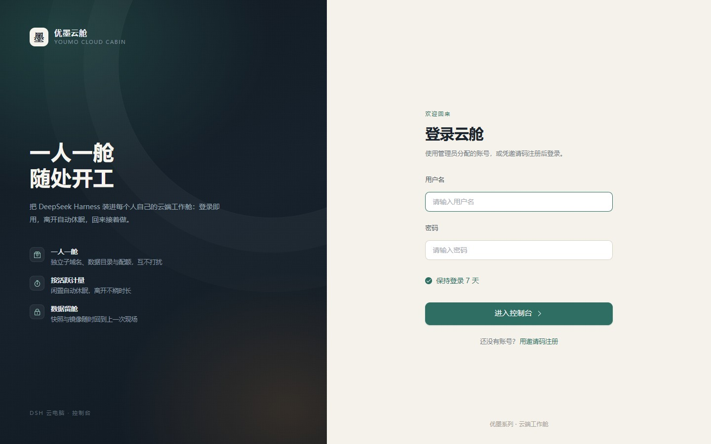
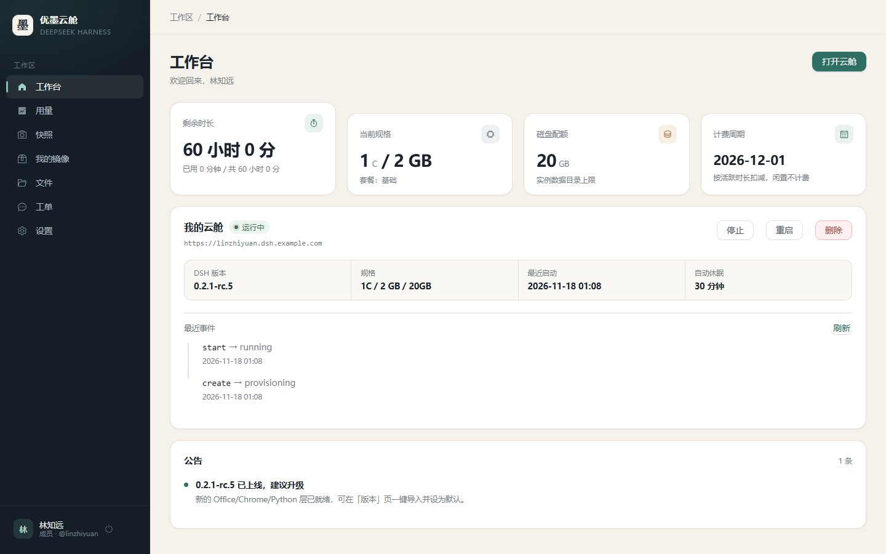
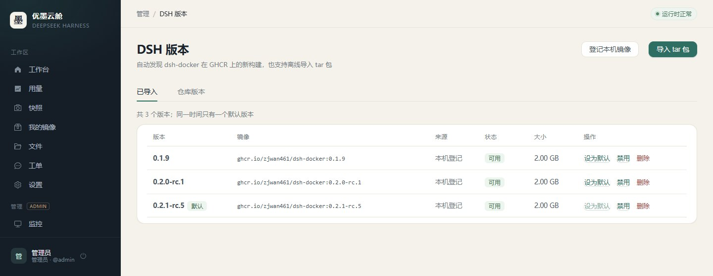
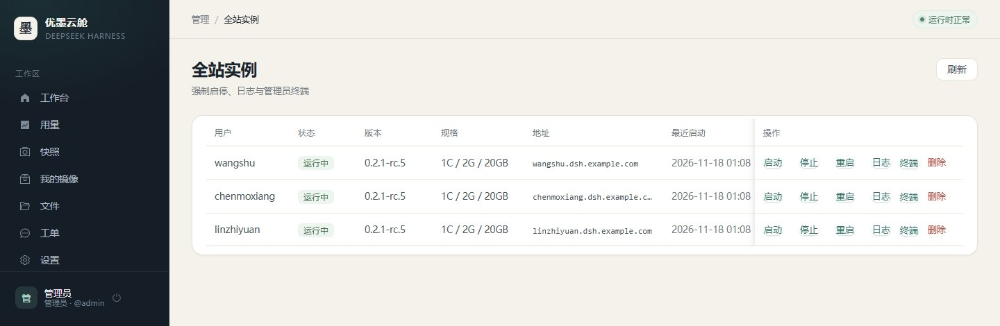
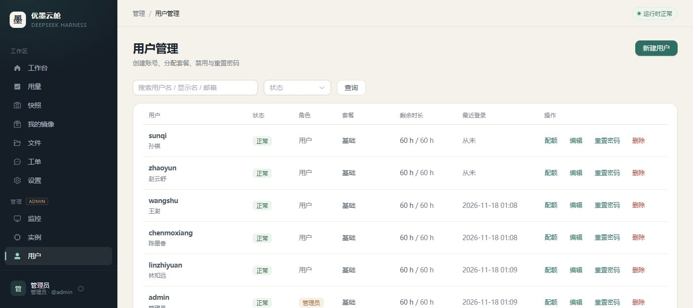
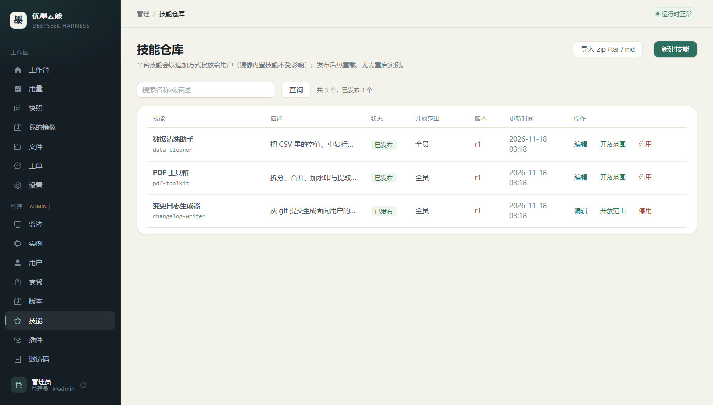
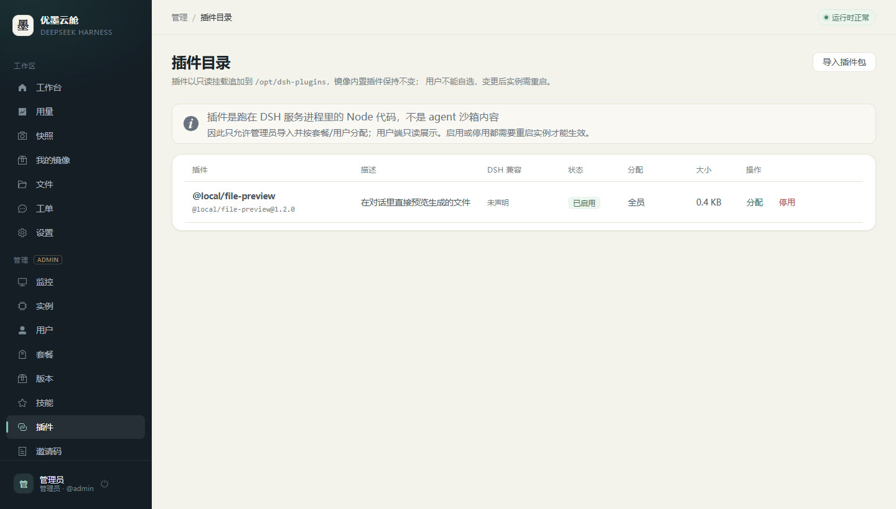
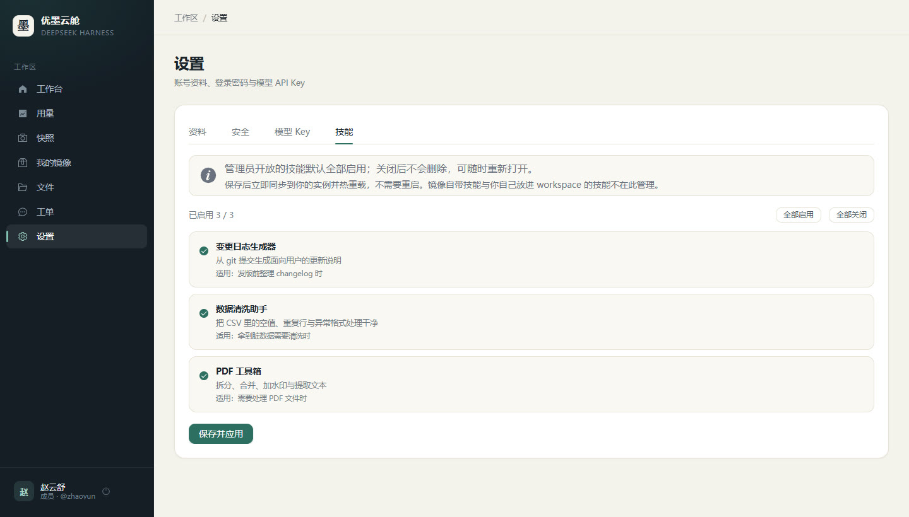
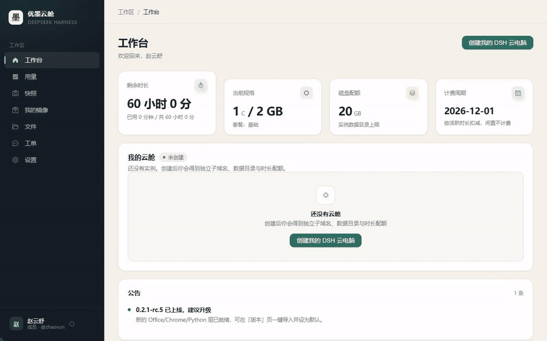
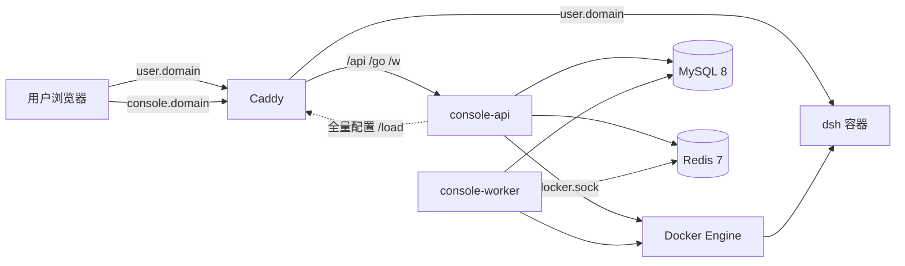

# 优墨云舱 · DSH 云电脑控制台

**一人一舱，随处开工。** 把 [`dsh-docker`](https://github.com/zjwan461/dsh-docker) 的单用户部署，变成**多用户、可计量、可运维**的云端工作舱：登录即用、离开休眠、按活跃时长计费、版本一键升级。

[](https://github.com/zjwan461/dsh-console/actions/workflows/build-images.yml)
[](https://github.com/zjwan461/dsh-console/actions/workflows/security.yml)




## 这是什么

每个用户不再是“共享服务器上的一个目录”，而是拿到**一间独立的舱**：

- **独立入口**：`<用户名>.<域名>` 子域名 + 单次 ticket 注入 token，点“打开云舱”直接进 DSH，不用自己配环境；
- **独立资源**：自己的容器、数据目录、CPU/内存/磁盘配额与时长；闲置自动休眠，回来点一下唤醒；
- **独立账本**：按活跃时长扣减，CPU/内存/网络用量按小时落库，管理员能看全站成本。

管理员在舱外统一调度：镜像版本、套餐配额、实例启停、全站监控、公告工单。

## 界面

| 工作台：配额、实例、公告 | 版本管理：GHCR 自动发现 / tar 离线导入 |
|---|---|
|  |  |
| **实例运维**：强制启停、日志、Web 终端 | **用户与配额**：套餐、时长、重置密码 |
|  |  |
| **技能仓库**：导入/在线编辑/发布/开放范围 | **插件目录**：兼容校验、按套餐分配 |
|  |  |

用户侧在「设置 → 技能」里默认全启用，可逐个关闭，保存即热重载：



### 从创建到终端（约 8 秒）



> 用户在工作台创建云舱 → 管理员在「全站实例」打开真实 PTY 终端（`docker exec` + xterm.js）。录屏使用本地 FakeDriver 演示环境。

## 核心能力

| 能力 | 说明 |
|---|---|
| 实例生命周期 | 创建 / 启动 / 停止 / 重启 / 删除；容器资源限制、健康检查、失败回滚；操作锁避免并发打架 |
| 访问与登录 | 每用户子域名；`/go/{ticket}` 单次 token 跳转；停止态落到唤醒页 `/w/{key}`，不泄露 token |
| 计量与配额 | worker 每 30s 采样 Docker stats，按小时聚合落库；活跃才扣时长；配额耗尽自动停机 |
| 闲置休眠 | 按网络/请求活动判定空闲，超时休眠；用户点击即唤醒，省内存也省时长 |
| 快照与镜像 | 数据快照往返；容器 commit 成个人镜像；版本切换；保留策略 |
| 版本治理 | 直接读 GHCR registry 元数据（不拉镜像）发现新构建，一键导入设默认；也支持 `docker save` tar 上传 |
| 模型接入 | Key + Base URL + 模型名可配；非 DeepSeek 模型自动生成 `openai-completions` 提供方 |
| 技能仓库 | 管理员导入 zip/tar/md、在线创建与编辑、版本回滚、按全员/套餐/用户开放；用户默认全启用、可关闭；物化到 `$DSH_HOME/skills` 热重载，镜像内置技能不受影响 |
| 插件目录 | 管理员导入 DSH bundle、记录 DSH 兼容范围、按套餐/用户分配；以只读挂载追加到 `/opt/dsh-plugins`，变更标记待重启；用户只读、不能自选 |
| 管理端 | 全站实例、强制操作、日志、真实 PTY Web 终端（xterm.js）、审计、公告、工单、邀请码 |
| 无感升级 | 每次启动自动把库迁到代码期望的 `head`；多 worker 用数据库锁串行化 |
| 部署 | 单机 Docker Compose；Caddy 动态路由；GHCR CI 出镜像；`app.cli doctor` 上线自检 |

## 架构



- **Caddy** 是唯一入口与 TLS 终结者，路由由 API 通过 admin API 全量下发；
- **console-api** 负责控制面（认证、实例、配额、Caddy 配置），挂载 `docker.sock`；
- **console-worker** 负责数据面采样（计量、休眠、配额、节点指标、Caddy 日志）；
- **技能**由 API 物化到实例的 `data/skills`（容器 `/data/dsh/skills`），DSH 热重载；**插件**以只读子路径挂载追加到 `/opt/dsh-plugins`，变更需重启容器；
- 每个用户一个 **dsh 容器**，只加入 `dsh-edge` 网络，不发布端口。

## 交付状态

- **功能**：M1–M5 已交付，并在真实 Docker / MySQL / Redis 上跑通端到端回归；此后补齐终端治理、启动迁移、模型端点、版本发现等生产化能力。
- **验证**：单元测试 **75 条**（SQLite + fakeredis + FakeDriver + 假 registry）；技能/插件另有 Playwright 冒烟脚本 `scripts/ui_smoke_skills.py`；真机回归脚本 `scripts/e2e_remote.py`、`e2e_terminal.py`、`e2e_registry.py`、`e2e_skills_plugins.py`（真实 MySQL + dsh-docker 镜像，30 项检查），结果与修掉的 bug 见 [路线图 §5](docs/06-roadmap.md) 与 [08 文档 §12](docs/08-skill-plugin-management.md)。
- **仓库卫生**：不含任何主机地址/口令；CI 的 `security.yml` 会扫描工作区与全部历史。

**为什么叫「云舱」**：每个用户拿到的不是一个抽象容器，而是一间独立的舱——有自己的子域名、数据目录、配额与时长；离开时自动休眠，回来点一下就能继续。舱与舱之间隔离，管理员在舱外统一调度。英文名可写作 **YouMo Cloud Cabin**。

## 快速开始（Docker）

```bash
cp .env.example .env
# 必改：SESSION_SECRET / MASTER_KEY / MYSQL_* / BOOTSTRAP_ADMIN_PASSWORD
# 若项目不在 /srv/dsh-console，把 HOST_DATA_ROOT 改成 "<项目绝对路径>/data"
mkdir -p data
docker compose up -d --build
docker compose logs -f console-api
```

打开 `https://console.dsh.example.com`（先把该域名解析到本机；Caddy 用内部 CA，需要信任根证书，见 [05 文档](docs/05-deployment-ops.md)）。

也可以直接用 CI 构建好的镜像，跳过本地构建：

```bash
# GHCR 上由 .github/workflows/build-images.yml 产出
docker pull ghcr.io/zjwan461/dsh-console-api:latest
docker pull ghcr.io/zjwan461/dsh-console-web:latest
```

先以管理员登录 → **版本** → 登记一个已经 `docker pull` 到本机的镜像（例如 `ghcr.io/you/dsh:0.2.1-rc.5`），再让用户创建实例。

> M2 起 `console-api` 挂载 `/var/run/docker.sock` 与 `./data`，并加入 `dsh-edge` 网络。这是 root 等价权限，务必只让 Caddy 访问 API，不要把 8000 端口发布出去。

### 管理员账号

首次启动且 `users` 表为空时，用 `BOOTSTRAP_ADMIN_USERNAME` / `BOOTSTRAP_ADMIN_PASSWORD` 创建（密码留空则随机生成并打印在日志里）。之后改环境变量不会重置任何账号，用 CLI 找回：

```bash
cd api
python -m app.cli list-users                                   # 有哪些账号
python -m app.cli reset-password admin --password 'NewPassw0rd!'  # 重置
python -m app.cli create-admin ops --password 'NewPassw0rd!'      # 再加一个管理员
python -m app.cli doctor                                          # 上线前自检
```

CLI 直接读写数据库、不经过 API，所以 API 挂了也能用；重置会同时吊销该账号的所有会话。详见 [05 文档 §3.3](docs/05-deployment-ops.md)。

## 本地开发（不需要 Docker / MySQL / Redis）

```bash
cd api
python -m pip install -e ".[dev]"
DATABASE_URL=sqlite:///./dev.db REDIS_FAKE=1 ENV=dev DOCKER_FAKE=1 CADDY_ENABLED=0 JOBS_INLINE=1 \
  DATA_ROOT=./data \
  uvicorn app.main:app --reload --port 8000
# 首次启动会用 BOOTSTRAP_ADMIN_PASSWORD 建管理员；未设置时随机生成并打印在日志里
```

> `DOCKER_FAKE=1` 用内存驱动模拟容器（创建/启停/日志 token 都可用），因此**不装 Docker 也能走通创建实例 → 打开 → 停止的完整链路**。

```bash
cd web
npm install
npm run dev          # http://127.0.0.1:5173，/api 代理到 :8000
```

- `ENV=dev` 时自动 `create_all`，不需要 Alembic；生产由容器 entrypoint 跑 `alembic upgrade head`。
- `REDIS_FAKE=1` 使用进程内 fakeredis，登录限流与会话不受影响。
- 计量与休眠需要 worker：另开终端 `python -m app.worker`（同样环境变量，本地加 `CADDY_ACCESS_LOG_ENABLED=0`）。
- 接口文档：`http://127.0.0.1:8000/api/docs`。

### 造演示数据 / 截图

```bash
python scripts/seed_demo.py     # 5 个用户、3 个版本、3 个实例、1 个工单与公告（连本地 API）
pip install playwright          # 截图工具，复用本机 Chrome，不下载浏览器
python scripts/shots.py --out shots/before
```

`shots.py` 会登录并截取工作台、用量、版本（含「仓库版本」页）、用户管理等页面，产物在 `shots/`（已 gitignore）。

## 界面设计

配色取「墨 + 纸」：深墨侧栏配暖白画布，主色为青墨 `#2f6f63`，辅以铜色 `#a9713f`。全部 token 在 `web/src/styles/main.css`，Element Plus 变量同源覆盖，因此新增页面自动继承字体、圆角、表格与按钮样式。

- 侧栏：工作区 / 管理两组，底部账号卡片；≤1080px 收成图标栏。
- 顶栏：面包屑 + 运行时状态胶囊（仅管理员）；页面标题只在内容区出现一次。
- 数据卡片：`stat-card` 提供图标片、主数值与说明三段式。
- 空状态：统一的 `.blank` 虚线块，替代 Element 默认插画。
- 登录页：左侧品牌叙事 + 右侧表单，窄屏自动隐藏左栏。

上面的截图由 `scripts/readme_shots.py` 生成（Playwright 驱动本机 Chrome，使用 `scripts/seed_demo.py` 的演示数据，不含真实主机信息）：

```bash
python scripts/seed_demo.py      # 本地 FakeDriver 环境
python scripts/readme_shots.py   # 输出 docs/images/*.jpg
python scripts/readme_demo.py    # 录屏并生成 docs/images/demo.gif（需要 ffmpeg）
```

## 真机回归脚本

`scripts/` 下是可复现的远端验证工具（不依赖本地 Docker）。**所有主机信息都从环境变量读取，仓库里不含任何 IP、端口或口令。**

```bash
cp scripts/.remote.env.example scripts/.remote.env   # 该文件已被 .gitignore 忽略
$EDITOR scripts/.remote.env                          # 填自己的 Docker/MySQL/Redis/域名
```

| 脚本 | 作用 |
|---|---|
| `provision_remote.py` | 建网络 `dsh-console` / `dsh-edge`、数据目录、专用 Redis |
| `build_remote.py` | 把 `api/` 与 `web/dist` 打成 tar 流，在远端 daemon 构建镜像 |
| `deploy_remote.py` | 起/更新 `console-api`、`console-worker`、`console-web`（纯 HTTP 模式，便于用 IP 验收） |
| `e2e_remote.py` | 端到端回归：容器资源限制、dsh 探活、token 302、计量落库、快照往返、文件越界、wake 页、停机/启动 |
| `e2e_terminal.py` | 管理员 WebSocket 终端（真实 `docker exec`） |
| `remote_exec.py` | 在远端容器里跑一段本地 Python 文件（排障用） |
| `clear_login_limit.py` | 清掉 Redis 里的 `rl:login:*`（回归脚本反复登录会触发限流） |

> 回归脚本每次运行都会真实登录，`LOGIN_RATE_PER_HOUR` 很容易打满；被限流时先跑 `clear_login_limit.py`，或临时调大该变量。

## 技术栈

| 层 | 选型 | 说明 |
|---|---|---|
| 前端 | Vue 3 + TypeScript + Vite + Pinia + Vue Router + Element Plus + ECharts | 控制台 SPA；监控图用 ECharts |
| 后端 | Python 3.12 + FastAPI + SQLAlchemy 2 + Alembic + Pydantic v2 | 同步 SQLAlchemy（线程池执行）；docker-py 走 unix socket |
| 任务 | `console-worker`（asyncio 常驻循环） | 计量采样/落库、休眠、配额、节点指标、Caddy 日志采集。未引入 ARQ：任务都是周期性的，换队列不影响业务层 |
| 数据库 | MySQL 8.4 | 业务数据；utf8mb4 |
| 缓存 | Redis 7 | 会话、登录限流、token 缓存、实例操作锁；单机也可用 fakeredis（仅开发） |
| 容器 | Docker Engine API（`/var/run/docker.sock`） | 单机；后期换 K8s 时加 Driver |
| 入口 | Caddy 2（管理 API 动态路由） | 唯一 TLS 终结者；泛域名内部 CA |

## 文档索引

| 文档 | 内容 |
|---|---|
| [01 需求与范围](docs/01-requirements.md) | 角色、用户故事、验收标准、一期/二期边界、已确认决策记录 |
| [02 架构设计](docs/02-architecture.md) | 组件、网络、Caddy 动态路由、token 注入、休眠唤醒、计量、快照、安全边界 |
| [03 数据模型](docs/03-data-model.md) | MySQL DDL、Redis 键、状态机、保留策略 |
| [04 API 契约](docs/04-api-contract.md) | REST/WS/SSE、请求响应示例、错误码、限流 |
| [05 部署与运维](docs/05-deployment-ops.md) | compose 拓扑、宿主机准备、首个管理员、备份恢复、升级、排障 |
| [06 路线图与风险](docs/06-roadmap.md) | 里程碑、验收、二期 GPU 方案、风险登记、待确认项 |
| [07 前端设计](docs/07-frontend.md) | 路由与页面、布局、状态管理、关键交互、工程结构 |
| [08 Skill 与插件管理](docs/08-skill-plugin-management.md) | 平台技能仓库、用户启用、物化与热重载；插件目录、合并根、patch 管理、兼容与回滚 |

## 目录结构

```
dsh-console/
├── api/                 # FastAPI 控制面
│   ├── app/             # 路由、模型、服务、安全、启动迁移
│   ├── alembic/         # 迁移
│   └── tests/           # SQLite + fakeredis + FakeDriver
├── web/                 # Vue3 + Element Plus SPA
├── deploy/              # Dockerfile.web / Caddyfile
├── docs/                # 设计与运维文档、README 截图
└── scripts/             # 本地演示、截图、真机回归工具
```

## 与 dsh-docker 的关系

- **镜像底座**：复用 `dsh-docker/Dockerfile` 构建的 `dsh:<version>`，一个版本一个镜像 tag；控制台只管理「已导入且启用」的版本。
- **不修改 dsh 本体**：所有多租户能力都在外层（容器编排、反代、计量），升级 dsh 版本不需要改控制台代码。
- **实例差异**：每个实例有独立的 `DSH_HOME`、workspace、子域名、`DSH_TRUSTED_HOSTS`；`login-gate` 插件在控制台模式下**关闭**（认证由控制台 + DSH token 承担，见 02 文档）。

## 许可证

本项目采用 **Apache License 2.0**，全文见 [`LICENSE`](LICENSE)。

Copyright 2026 zjwan461

你可以自由使用、修改、分发（包括商业用途），但需保留许可证与版权声明；分发修改后的版本时需说明改动。完整条款以 `LICENSE` 为准。
